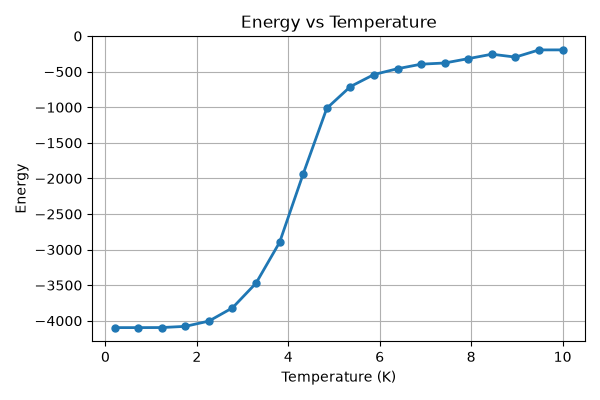
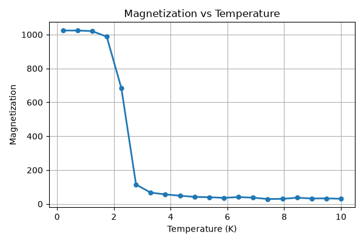
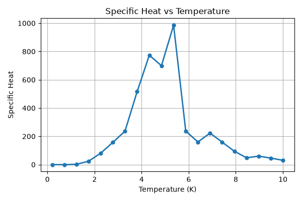
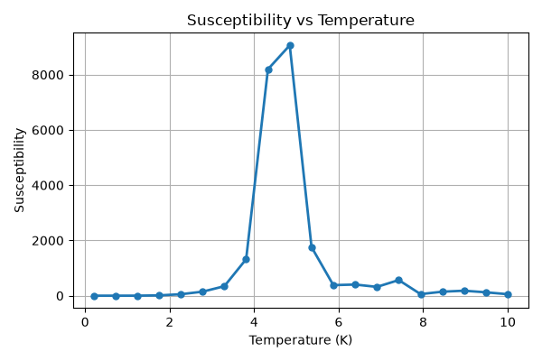

# 2D / 3D Ising Model Monte Carlo Simulation

A modular Python implementation of **2D and 3D Ising Models** using the **Wolff Cluster Algorithm** for Monte Carlo simulations of phase transitions.

---

## Overview

The Ising model is one of the most important models in statistical physics for studying ferromagnetism and critical phenomena.

This project implements two- and three-dimensional Ising models with periodic boundary conditions and the Wolff Cluster Algorithm, which efficiently reduces critical slowing down near the phase transition.

---

## Features

- 2D and 3D Ising models
- Wolff Cluster Monte Carlo algorithm
- Periodic boundary conditions
- Configurable lattice dimension
- Temperature sweep simulation
- Automatic calculation of
  - Energy
  - Magnetization
  - Specific Heat
  - Magnetic Susceptibility
- Automatic generation of result figures

---

## Project Structure

```text
ising-model/
│
├── figures/
├── notebooks/
├── src/
│   ├── algorithms.py
│   ├── lattice.py
│   ├── observables.py
│   ├── plotting.py
│   ├── runner.py
│   └── simulation.py
│
├── main.py
├── requirements.txt
└── README.md
```

---

## Installation

```bash
git clone https://github.com/ziyingyang519/ising-model.git

cd ising-model

pip install -r requirements.txt
```

---

## Usage

```bash
python main.py
The lattice dimension can be selected by setting the `dimension` parameter in `main.py`.

Example:

- `dimension=2` → 2D Ising model
- `dimension=3` → 3D Ising model
```

Running the program automatically:

- performs Monte Carlo simulations
- sweeps over a range of temperatures
- computes thermodynamic observables
- saves all figures into the `figures/` folder

---

## Results

The simulated critical temperature is approximately 4.9 (simulation units), estimated from the peaks of the specific heat and magnetic susceptibility. This is reasonably close to the accepted value for the three-dimensional Ising model (T
c
	​

≈4.51), given the finite lattice size and limited Monte Carlo sampling.

### Energy



---

### Magnetization



---

### Specific Heat



---

### Magnetic Susceptibility



---

## Physics Background

The Ising model describes interacting magnetic spins

$
s_i=\pm1
$

with Hamiltonian

$$H = -J \sum_{\langle i,j \rangle} s_i s_j, \quad s_i = \pm 1$$

Estimated critical temperature: $T_c \approx 4.9\ J/k_B$

The Wolff Cluster Algorithm greatly improves sampling efficiency near the critical temperature by flipping clusters of aligned spins instead of individual spins.

---

## Future Work

- Metropolis Algorithm
- Finite-size scaling analysis
- Binder cumulant
- Parallel simulations

---

## Author

**Zi-Ying Yang**

Department of Biomechatronics Engineering

National Taiwan University

---

## License

MIT License
